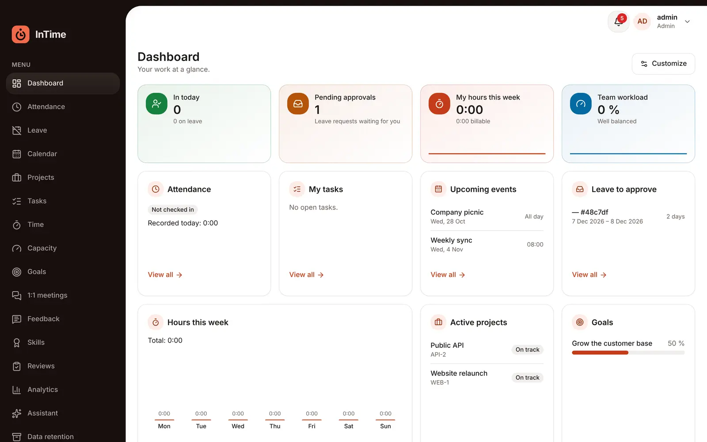
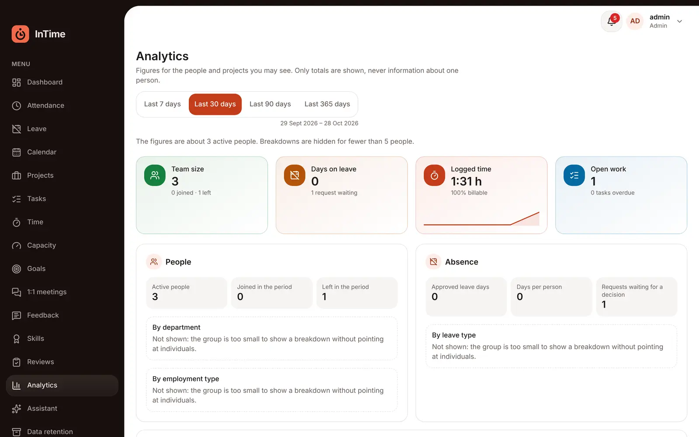
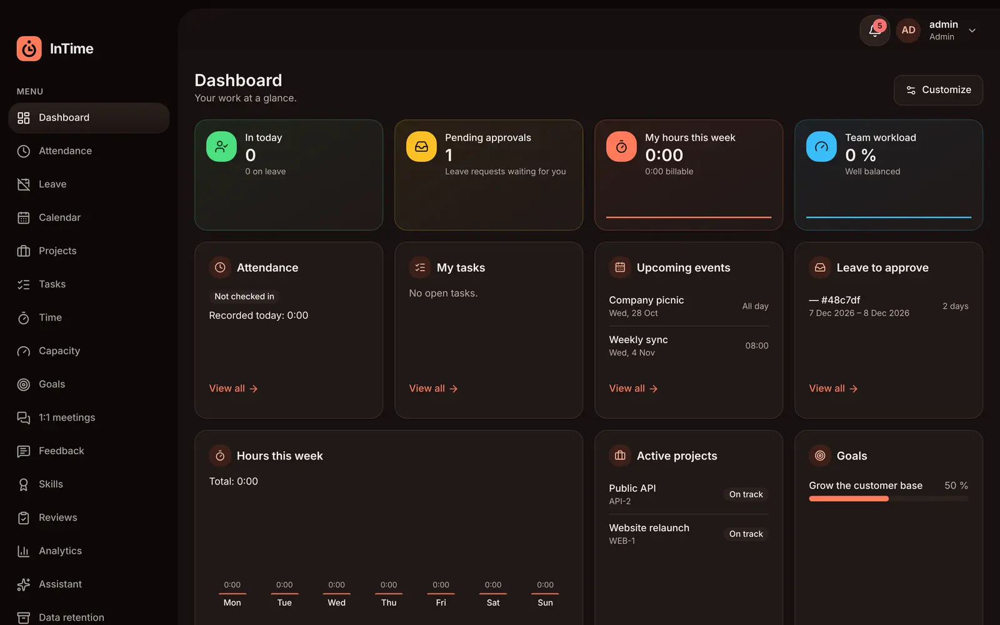
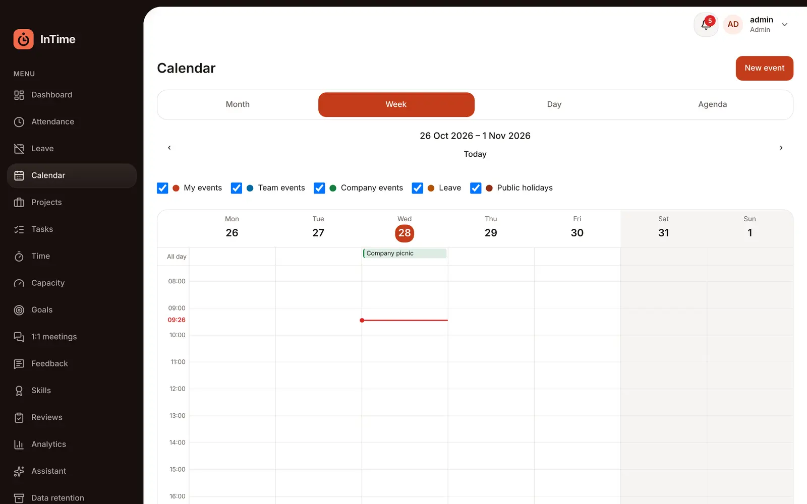
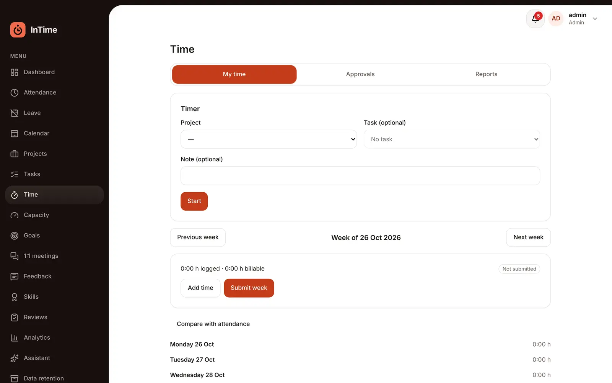
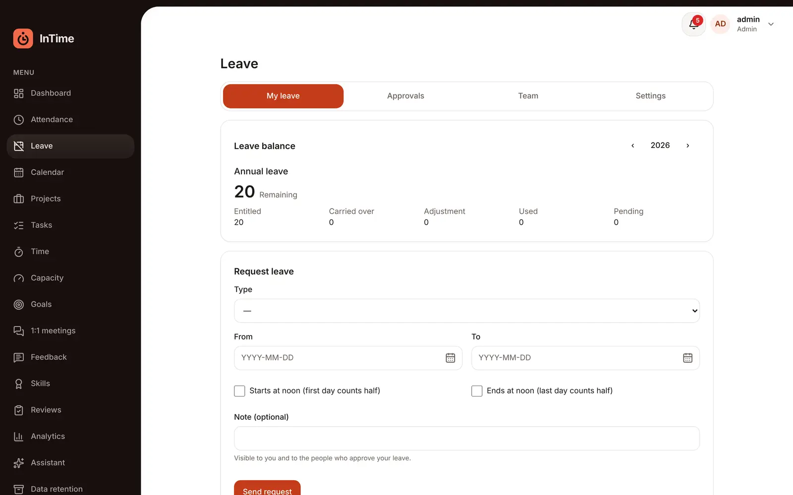
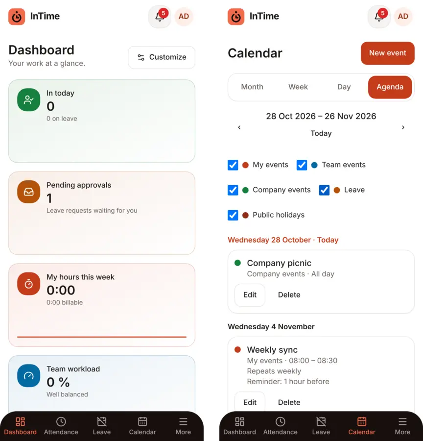

<a id="readme-top"></a>

<div align="center">


# InTime

**People, time and projects for small and mid-size teams, in one place.**

[](https://github.com/georgi4334/Manager-Employee-Software/actions/workflows/ci.yml)




</div>

## Table of contents

- [Description](#description)
- [How to install and run the project](#how-to-install-and-run-the-project)
- [How to use the project](#how-to-use-the-project)
- [Roles and permissions](#roles-and-permissions)
- [AI assistant](#ai-assistant)
- [Configuration](#configuration)
- [Tests](#tests)
- [Deployment](#deployment)
- [Project structure](#project-structure)
- [Documentation](#documentation)
- [Roadmap](#roadmap)
- [How to contribute](#how-to-contribute)
- [Credits](#credits)
- [License](#license)

## Description

InTime is a web app for running a team of up to a few hundred people: who works here and for whom, who is off, who is in today, what everybody is working on and how many hours it took, and how people grow. It is multi-tenant (several companies on one installation, strictly separated), built for the EU (GDPR by design, EU hosting) and runs on free plans.

### What it does

- **People:** employee directory and profiles, departments, teams and reporting lines with an org chart, per-person working hours, and pay records for HR (records only, nothing is calculated).
- **Absence and presence:** leave types, policies and balances with request → approval, public holidays for Bulgaria and Germany, self-reported check-in/check-out with corrections, and a "who is in today" view.
- **Calendar:** month, week, day and agenda views with personal, team and company events, repeating events, guests with answers, "find a time" and reminders. Leave and holidays are shown as layers.
- **Projects and time:** clients, projects with milestones and staffing, tasks (list and board), a timer and weekly timesheets with approval, reports and CSV export, budget versus actual and team capacity.
- **Growth:** goals with key results (personal, team, company), 1:1 meetings with private notes and action items, named feedback, a skills matrix and performance review cycles with calibration.
- **Insight:** a dashboard the administrator arranges from 25 widgets, and analytics with counts only (small groups are hidden).
- **Administration:** invitations, system and custom roles with a permission editor, an append-only audit log, notifications (in-app and email) with preferences, data export and erasure, and automatic retention for Bulgaria.
- **AI assistant (optional, bring your own key):** answers questions about your own data and, if you allow it, about people you may already see, using read-only tools that run with your rights.
- English, German and Bulgarian; light and dark themes; phone layouts; keyboard-friendly and checked for accessibility on every page.

### Why these technologies

- **React 19, Vite and Tailwind** with design tokens in one file, so the whole look (light and dark) changes in one place. **TanStack Query** for server data, **Zustand** for small UI state. Everything is **TypeScript 6** in strict mode.
- **NestJS and PostgreSQL with Prisma** for a modular API where every feature is its own module. **Row Level Security** in the database keeps companies apart, even if application code has a bug.
- **Zod schemas and pure rule functions in a shared package** (`@intime/contracts`), so the web app and the API agree on every request, permission and calculation (leave days, capacity, recurrence, money parsing).
- **Free EU plans only** (Cloudflare Pages, Render, Neon, Resend), which shaped several choices below.

### Challenges

- **Tenant isolation that does not rely on discipline:** every request runs in a transaction with the company set for Row Level Security, the API refuses to start with a database role that could bypass it, and a test fails if a new table forgets its policy.
- **Permissions with scope:** a permission is held at a scope (own, direct reports, team, department, all) that is checked against the real org chart on every request. Nobody can grant what they do not hold, and the last administrator cannot be removed.
- **Sensitive data:** the reason for sick leave is never stored, pay never leaves HR, 1:1 private notes are visible to their writer only, and audit entries and notifications carry ids, never names or free text.
- **Time is hard:** times are typed in the company's time zone and stored as instants, repeating events keep their local time across daylight saving, and leave counting respects holidays per country.
- **Free plans:** no queue service (a transactional outbox in Postgres), an API that sleeps when idle (the app explains the wait) and an hourly pinger for reminders.

### What is planned

Everything in the roadmap is built; the next steps are the first deployment on free plans and file storage (avatars). See the [roadmap](#roadmap).

<p align="right">(<a href="#readme-top">back to top</a>)</p>

## How to install and run the project

### Requirements

- Node.js 22+ (see `.nvmrc`)
- pnpm 10 (`corepack enable` picks the version from `package.json`)
- Docker Desktop, for the local Postgres database (or a PostgreSQL 16 of your own)

### Installation

```bash
git clone https://github.com/georgi4334/Manager-Employee-Software.git
cd Manager-Employee-Software
pnpm install
docker compose up -d                          # Postgres 16 on port 5432, creates the database roles
cp apps/api/.env.example apps/api/.env
pnpm --filter @intime/api db:deploy           # apply the migrations
pnpm build                                    # build the shared package and the API once
pnpm --filter @intime/api tenant:create --name "Acme" --slug acme --admin-email admin@acme.eu
pnpm dev                                      # web on :5173, api on :3000 (API docs at /api/docs)
```

`tenant:create` creates the first company and invites its administrator. In development emails are not sent: the invitation link is printed in the API terminal. Open it, choose a password and you are signed in as the administrator. From there, invite the rest of the team under **Employees**.

Notes:

- `pnpm dev` builds `@intime/contracts` first and keeps it rebuilding while you work, so the web app and the API always see the current shared code. If you start an app on its own, run `pnpm --filter @intime/contracts build` after pulling.
- After a schema change in a pull, run `pnpm --filter @intime/api db:deploy` again.
- Accounts created before roles existed can be given one: `pnpm --filter @intime/api roles:grant --workspace acme --email admin@acme.eu --role admin`.

### Commands

| Command                                                 | What it does                                                 |
| ------------------------------------------------------- | ------------------------------------------------------------ |
| `pnpm dev`                                              | Run the shared package, web and API in watch mode            |
| `pnpm build`                                            | Build all packages                                           |
| `pnpm test`                                             | Vitest in every package (API database tests need a database) |
| `pnpm lint`                                             | ESLint across the repo                                       |
| `pnpm typecheck`                                        | TypeScript check in every package                            |
| `pnpm format`                                           | Format with Prettier                                         |
| `pnpm --filter @intime/e2e e2e`                         | Browser and accessibility tests (Playwright)                 |
| `pnpm --filter @intime/api db:migrate -- --name <what>` | Create a migration after editing `schema.prisma`             |
| `pnpm --filter @intime/api db:deploy`                   | Apply migrations                                             |
| `pnpm --filter @intime/api tenant:create …`             | Create a company and invite its first administrator          |
| `pnpm --filter @intime/api roles:sync`                  | Bring system roles in line with the permission catalog       |
| `pnpm --filter @intime/contracts docs:permissions`      | Regenerate `docs/permission-matrix.md`                       |

A pre-commit hook (Husky + lint-staged) lints and formats staged files, and commitlint checks for [conventional commits](https://www.conventionalcommits.org/).

<p align="right">(<a href="#readme-top">back to top</a>)</p>

## How to use the project

1. **Set up the company** as the administrator: add departments and teams under **Organization**, invite people under **Employees** and give them a manager and a role. Leave types and policies are under **Leave → Settings**.
2. **Every day:** check in and out under **Attendance**, request leave under **Leave**, see the team and company **Calendar**, and log hours with the timer under **Time**. The bell shows what needs your attention.
3. **Managers** approve leave and timesheets, see who is in, plan **Capacity** and staff **Projects**, assign **Tasks**, hold **1:1 meetings** and write reviews.
4. **Growth:** set **Goals** with key results, give **Feedback**, rate **Skills** and take part in **Reviews** when HR opens a cycle.
5. **Overview:** the **Dashboard** shows the widgets the administrator chose (each person only sees what they may), and **Analytics** shows totals for a period.
6. **Your data:** under **Profile** you can download everything the app holds about you. HR can export or erase the data of a former employee.

<table>
  <tr>
    <td width="50%"><br><sub>Analytics</sub></td>
    <td width="50%"><br><sub>Dark theme</sub></td>
  </tr>
  <tr>
    <td width="50%"><br><sub>Calendar</sub></td>
    <td width="50%"><br><sub>Time tracking</sub></td>
  </tr>
  <tr>
    <td width="50%"><br><sub>Leave</sub></td>
    <td width="50%"><br><sub>On a phone</sub></td>
  </tr>
</table>

The interface is available in English, German and Bulgarian (in the profile menu). Texts live in `apps/web/src/i18n/locales/{en,de,bg}`; a test fails when a language misses a text.

<p align="right">(<a href="#readme-top">back to top</a>)</p>

## Roles and permissions

Four system roles come with every company: **Admin**, **HR**, **Manager** and **Employee**. Each holds permissions at a scope (own, direct reports, team, department or all), for example an employee sees their own attendance, a manager their team's, HR everybody's. Administrators can add custom roles in **Roles**, but never with more rights than they hold themselves.

The server is the only authority: hiding a button in the web app is cosmetic. The full matrix is generated from the code into [`docs/permission-matrix.md`](docs/permission-matrix.md).

## AI assistant

The assistant is **off by default**. An administrator switches it on for the company, and each person accepts a short notice before the first question. It works with your own API key (or a company key) for one of a fixed list of providers (Google Gemini, Groq, OpenRouter or Mistral). Keys are encrypted with AES-256-GCM, never sent back to the browser and never logged.

The model can only call read-only tools that run with the asking person's rights, so it sees exactly what that person may see. Questions about other people are possible only after the person allows it in the assistant settings. Only the question and the answer are stored, and they are deleted after the company's retention period.

> **Privacy note:** free AI plans may use what you send to improve their products and may process it outside the EU. Keep the switch off unless the company has decided otherwise.

<p align="right">(<a href="#readme-top">back to top</a>)</p>

## Configuration

Settings for the API live in `apps/api/.env` (copy from `.env.example`; the API checks them at start-up and refuses to run with a bad value).

| Variable                 | Default (development)      | Meaning                                                                     |
| ------------------------ | -------------------------- | --------------------------------------------------------------------------- |
| `DATABASE_URL`           | `intime_app` role          | Runtime connection; Row Level Security limits it to the current company     |
| `SYSTEM_DATABASE_URL`    | `intime_system` role       | Cross-company work only: sign-in, provisioning, background jobs             |
| `MIGRATION_DATABASE_URL` | table owner                | Used by migrations only, never by the running API                           |
| `WEB_APP_URL`            | `http://localhost:5173`    | Where the web app lives; links in emails point here                         |
| `JWT_ACCESS_SECRET`      | a development value        | Signs sign-in tokens (32+ characters; production needs its own)             |
| `MAIL_TRANSPORT`         | `log`                      | `log` prints emails in the terminal, `resend` sends them (`RESEND_API_KEY`) |
| `GOOGLE_CLIENT_ID` …     | (empty: off)               | Optional Google sign-in (client id, secret and redirect URL)                |
| `REMINDERS_TOKEN`        | (empty: hook off)          | Secret for the hourly reminder hook called by an external scheduler         |
| `AI_KEY_ENCRYPTION_KEY`  | (empty: no stored keys)    | Encrypts the AI keys people save                                            |
| `CORS_ORIGINS`           | `http://localhost:5173`    | Browser origins allowed to call the API                                     |
| `SWAGGER_ENABLED`        | `true` (off in production) | Interactive API docs at `/api/docs`                                         |

Production values (cookies, proxy hops, email) are described in the [deployment runbook](docs/deployment.md).

<p align="right">(<a href="#readme-top">back to top</a>)</p>

## Tests

- `pnpm test`: unit tests in every package and API tests against a real database when `TEST_DATABASE_URL` is set (CI always sets it). Every feature has positive and negative cases: wrong role, wrong company, not found, duplicates, boundaries. Every tenant table has an isolation test, every route must declare its protection (a test lists them), and the permission matrix is tested role by role.
- `pnpm --filter @intime/e2e e2e`: browser tests with Playwright against a fresh database, a real `tenant:create` and the Vite dev server. They cover onboarding, leave, attendance, calendar, projects, tasks, time, reports, capacity, goals, 1:1s, feedback, skills, reviews, analytics, compensation, roles, privacy and retention, the dashboard and motion. Set `E2E_DATABASE_URL` to a Postgres owner URL first.
- **Accessibility:** `06-accessibility.spec.ts` scans every page with axe (WCAG 2.1 A and AA) on a phone and a desktop, in light and dark.

CI runs the format check, lint, type checks, all tests and the build on every push and pull request, and the browser tests as a separate job.

## Deployment

Everything runs on free EU plans:

```
Browser ──► Cloudflare Pages (web app + /api proxy function) ──► Render, Frankfurt (API)
                                                                   ├──► Neon, Frankfurt (Postgres)
                                                                   └──► Resend (emails)
GitHub Actions ──► CI, deploy on main, hourly reminder ping
```

Releases go only through `.github/workflows/deploy.yml` on `main` after CI. Migrations run before the new code, so every migration stays compatible with the previous release. Step-by-step guide: [`docs/deployment.md`](docs/deployment.md).

## Project structure

```
apps/
  web/        React 19 + Vite + Tailwind (React Router, TanStack Query, Zustand, react-i18next)
  api/        NestJS + Prisma (PostgreSQL with Row Level Security), one module per feature
packages/
  contracts/  Zod schemas, permission catalog, notification catalog and pure business rules
e2e/          Browser and accessibility tests (Playwright)
docs/         Data model, permission matrix, roadmap, deployment runbook, decisions (adr/)
docker/       Local Postgres set-up (roles for the app, the system and migrations)
```

Inside the apps, code is organised by feature: `apps/web/src/features/<feature>` and `apps/api/src/modules/<feature>`.

## Documentation

| Document                                                 | What is in it                                                  |
| -------------------------------------------------------- | -------------------------------------------------------------- |
| [`docs/data-model.md`](docs/data-model.md)               | Tables, relations and what each one holds                      |
| [`docs/permission-matrix.md`](docs/permission-matrix.md) | Every permission with its scopes and default roles (generated) |
| [`docs/roadmap.md`](docs/roadmap.md)                     | Phases, scope and the definition of done                       |
| [`docs/deployment.md`](docs/deployment.md)               | Deploying on free plans and operating the live site            |
| [`docs/adr/`](docs/adr)                                  | 34 decision records, one per feature or design choice          |
| [`CLAUDE.md`](CLAUDE.md)                                 | Working rules and conventions for each module                  |

<p align="right">(<a href="#readme-top">back to top</a>)</p>

## Roadmap

- [x] Foundation: monorepo, CI, tenancy with Row Level Security, sign-in (email and Google), roles and permissions, notifications
- [x] Employees, organization, leave, attendance, calendar, data export and erasure
- [x] Clients and projects, tasks, time tracking, time reports, capacity
- [x] Goals, 1:1 meetings, feedback, skills matrix
- [x] Performance reviews and analytics
- [x] AI assistant, repeating events with guests and reminders, working hours, retention for Bulgaria, compensation records, role editor
- [x] Customizable dashboard, motion, new visual style, logo and splash screen
- [ ] First deployment on free plans
- [ ] File storage (avatars, attachments)
- [ ] Retention presets for more countries

The plan and the decision behind each step are in [`docs/roadmap.md`](docs/roadmap.md) and [`docs/adr/`](docs/adr).

<p align="right">(<a href="#readme-top">back to top</a>)</p>

## How to contribute

This is a personal project, but suggestions and bug reports are welcome. Open an issue, branch from `dev`, run `pnpm lint && pnpm typecheck && pnpm test`, and open a pull request against `dev` (never `main`). Commits follow conventional commits (`feat:`, `fix:`, `docs:` …).

## Credits

Built by [Georgi](https://github.com/georgi4334), with Claude Code as a coding assistant.

Thanks to:

- [Lucide](https://lucide.dev/) for the icons
- [axe-core](https://github.com/dequelabs/axe-core) and [Playwright](https://playwright.dev/) for the accessibility and browser tests
- [Shields.io](https://shields.io/) for the badges
- The free plans of Cloudflare, Render, Neon and Resend that make a hobby deployment possible

## License

No license has been chosen yet, so all rights are reserved. Please ask before reusing the code.

<p align="right">(<a href="#readme-top">back to top</a>)</p>
