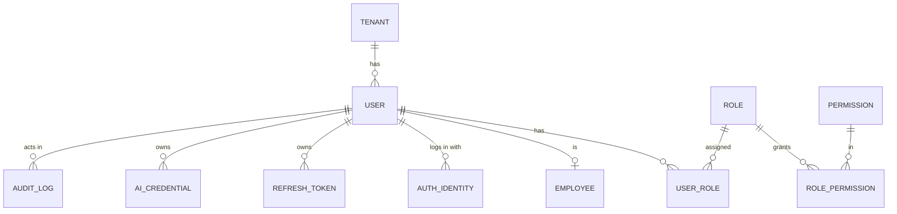
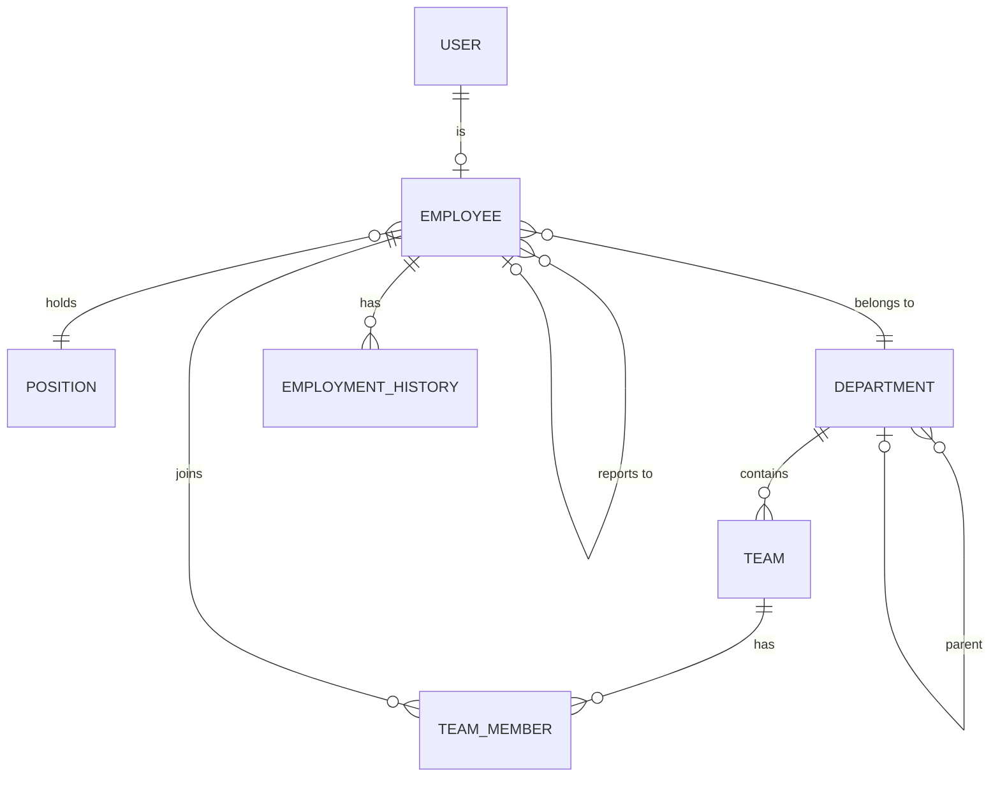
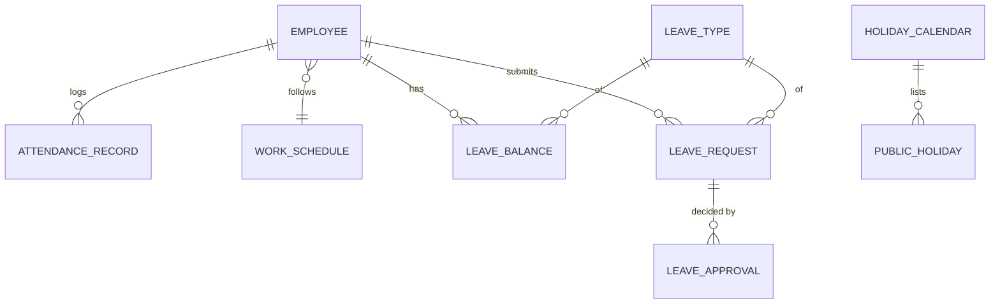
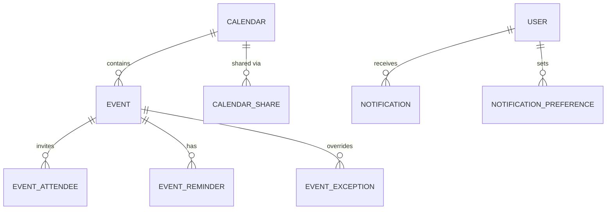
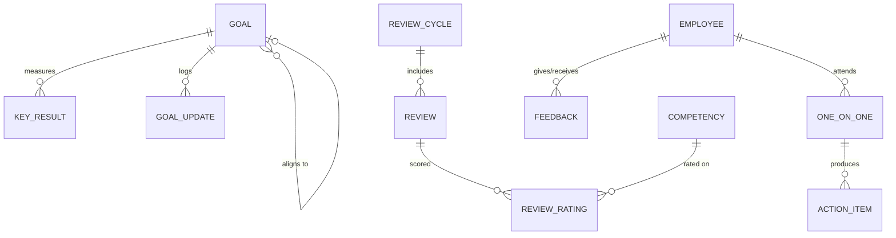
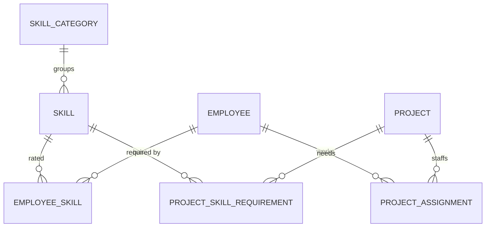
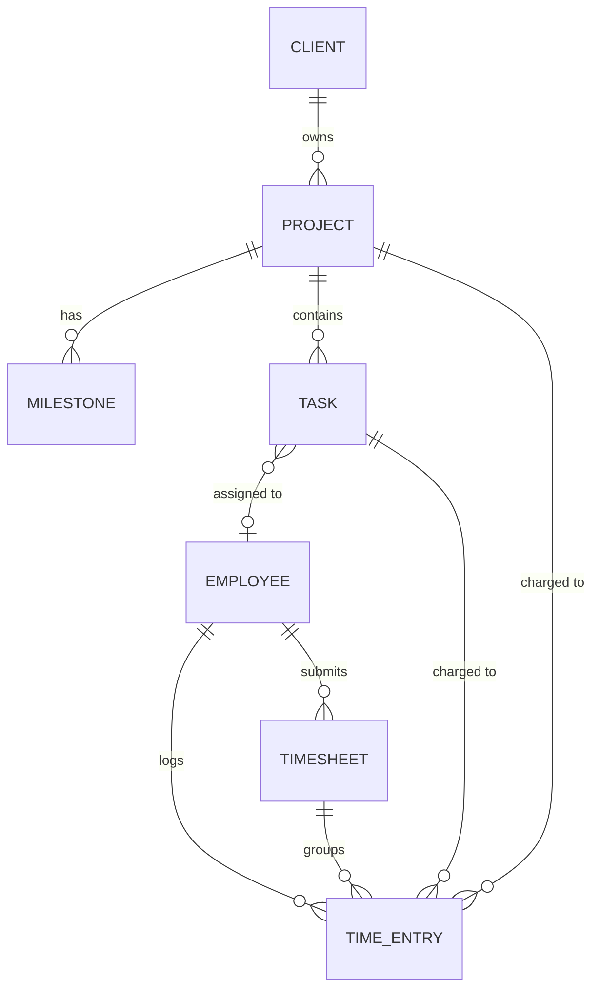

# InTime — Data Model (ERD)

PostgreSQL, EU region. Conventions apply to **every** table unless stated:

- `id uuid` primary key (UUIDv7 where possible, sortable).
- `tenant_id uuid NOT NULL DEFAULT public.app_current_tenant()` + Row Level Security enabled in the table's migration with `SELECT public.enable_tenant_rls('<table>');` (see [ADR 0001](adr/0001-multi-tenancy-rls.md)).
- `created_at`, `updated_at timestamptz`, `created_by`, `updated_by` (user id).
- Soft delete (`deleted_at`) for people-related data; hard purge by the retention job (GDPR).
- Unique constraints are always composite with `tenant_id`.
- Enums are stored as `text` + check constraint (easier migrations than PG enums).

## 1. Identity, tenancy, access

| Table                     | Key columns                                                                                                                                                                                |
| ------------------------- | ------------------------------------------------------------------------------------------------------------------------------------------------------------------------------------------ |
| `tenant`                  | name, slug, default_locale, default_timezone, country, ai_enabled, settings jsonb                                                                                                          |
| `user`                    | email (unique per tenant), status (`invited/active/disabled`), locale, timezone, email_verified_at, last_login_at                                                                          |
| `auth_identity`           | user_id, provider (`password/google`), provider_subject, password_hash (argon2id, only for `password`)                                                                                     |
| `refresh_token`           | user_id, token_hash, family_id, expires_at, revoked_at, replaced_by (reuse detection)                                                                                                      |
| `invitation`              | _(not a table: invitations are `auth_token` rows with purpose `invite`, see ADR 0002)_                                                                                                     |
| `role`                    | key (admin/hr/manager/employee for system roles, null for custom), name, description, is_system — unique (tenant, name) and (tenant, key)                                                  |
| _(no `permission` table)_ | The permission catalog lives in code (`@intime/contracts`); the database only stores grants. See [ADR 0003](adr/0003-roles-and-permissions.md)                                             |
| `role_permission`         | role_id, permission_code (validated against the catalog), **scope** (`own/reports/team/department/all`) — primary key (role, code)                                                         |
| `user_role`               | user_id, role_id (composite tenant-safe FKs; a role in use cannot be deleted)                                                                                                              |
| `audit_log`               | actor_user_id (no FK, pseudonymous), action, entity, entity_id, before jsonb, after jsonb, created_at — **append-only by privilege** (UPDATE revoked from all runtime roles; no IP stored) |
| `ai_credential`           | owner_type (`user/tenant`), owner_id, provider, model, key_ciphertext, key_iv, key_tag, key_last4, created_at (AES-256-GCM)                                                                |

## 2. Employees & organization

| Table                | Key columns                                                                                                                                                                                                                                                                                                                                                                                                                                                                                                                    |
| -------------------- | ------------------------------------------------------------------------------------------------------------------------------------------------------------------------------------------------------------------------------------------------------------------------------------------------------------------------------------------------------------------------------------------------------------------------------------------------------------------------------------------------------------------------------ |
| `employee`           | user_id (nullable, unique), employee_no, first_name, last_name, job_title, location, employment_type (`full_time/part_time/contractor/outsourced`), seniority (`intern/junior/mid/senior/lead/principal`), hire_date, termination_date, birth_date, phone, country, status (`active/inactive`) — **step 1, see [ADR 0006](adr/0006-employees.md)**; no work_email (email lives on `app_user`). Added in Organization: position_id, department_id, manager_id → employee, work_schedule_id. Added with file storage: avatar_url |
| `position`           | title, level, description                                                                                                                                                                                                                                                                                                                                                                                                                                                                                                      |
| `department`         | name, parent_id, head_employee_id                                                                                                                                                                                                                                                                                                                                                                                                                                                                                              |
| `team`               | name, department_id, lead_employee_id                                                                                                                                                                                                                                                                                                                                                                                                                                                                                          |
| `team_member`        | team_id, employee_id, role_in_team, from_date, to_date                                                                                                                                                                                                                                                                                                                                                                                                                                                                         |
| `employment_history` | employee_id, change_type (`hire/promotion/transfer/manager_change`), old/new values jsonb, effective_date                                                                                                                                                                                                                                                                                                                                                                                                                      |

- Reporting tree: `manager_id` + recursive CTE (`WITH RECURSIVE`) to resolve `direct_reports` / `all subordinates`; cycle check on write.
- Compensation (salary) is **deferred** — separate `compensation` table later, permission `compensation.view` (HR + Admin only).

## 3. Attendance & leave

| Table               | Key columns                                                                                                                                                                                                                        |
| ------------------- | ---------------------------------------------------------------------------------------------------------------------------------------------------------------------------------------------------------------------------------- |
| `work_schedule`     | name, weekly_hours, days jsonb (per weekday start/end/break)                                                                                                                                                                       |
| `attendance_record` | employee_id, work_date, check_in_at, check_out_at, mode (`office/remote/field`), note, source=`manual` — unique(employee_id, work_date, check_in_at)                                                                               |
| `leave_type`        | code (`annual/sick/unpaid/parental/other`), name (i18n key), is_paid, requires_approval, requires_document, color_token, deduct_from_balance                                                                                       |
| `leave_policy`      | leave_type_id, annual_allowance_days, accrual (`yearly/monthly`), carry_over_max_days, country                                                                                                                                     |
| `leave_balance`     | employee_id, leave_type_id, year, entitled, used, pending, carried_over                                                                                                                                                            |
| `leave_request`     | employee_id, leave_type_id, start_date, end_date, half_day_start/end, days (computed server-side excluding weekends + holidays), reason (**not** shown for sick), status (`draft/pending/approved/rejected/cancelled`), decided_at |
| `leave_approval`    | leave_request_id, approver_id, step, decision, comment, decided_at (supports multi-step later)                                                                                                                                     |
| `holiday_calendar`  | country, region, year                                                                                                                                                                                                              |
| `public_holiday`    | holiday_calendar_id, date, name (i18n), is_half_day                                                                                                                                                                                |

- **Sick leave** stores only the type — never diagnosis (GDPR special category).
- Overlap rule: an employee cannot have two non-cancelled requests overlapping (exclusion constraint on daterange).

## 4. Calendar & notifications

| Table                     | Key columns                                                                                                                                                                                                                      |
| ------------------------- | -------------------------------------------------------------------------------------------------------------------------------------------------------------------------------------------------------------------------------- |
| `calendar`                | name, owner_type (`user/team/department/company`), owner_id, color_token, is_system_layer (leave/holidays/birthdays)                                                                                                             |
| `calendar_share`          | calendar_id, grantee_type (`user/team/all`), grantee_id, access (`free_busy/view/edit/manage`)                                                                                                                                   |
| `event`                   | calendar_id, title, description, location, meeting_url, starts_at, ends_at, all_day, timezone, rrule (nullable), visibility (`default/private/public`), organizer_id, source_type/source_id (e.g. `leave_request`, `one_on_one`) |
| `event_exception`         | event_id, original_start, is_cancelled, override fields jsonb                                                                                                                                                                    |
| `event_attendee`          | event_id, user_id, rsvp (`pending/yes/no/maybe`), is_optional                                                                                                                                                                    |
| `event_reminder`          | event_id, user_id, minutes_before, channel (`in_app/email`)                                                                                                                                                                      |
| `notification`            | recipient_user_id, type, params jsonb (ids/non-sensitive labels), link, in_app, read_at, email_status (`none/pending/sending/sent/failed/skipped`), attempts, next attempt, sent_at                                              |
| `notification_preference` | user_id, type, channel (`in_app/email`), enabled (digest later)                                                                                                                                                                  |
| `outbox_event`            | type, params jsonb, status (`pending/processing/done/dead`), attempts, available_at, locked_until, last_error — queue + event log; app role can only INSERT (ADR 0004)                                                           |

## 5. Goals, performance, 1:1s, feedback

| Table           | Key columns                                                                                                                                                                      |
| --------------- | -------------------------------------------------------------------------------------------------------------------------------------------------------------------------------- |
| `goal`          | scope (`personal/team/company`), owner_id (employee/team/tenant), parent_goal_id, title, description, status (`draft/active/done/cancelled`), progress_pct, due_date, visibility |
| `key_result`    | goal_id, title, target_value, current_value, unit                                                                                                                                |
| `goal_update`   | goal_id, author_id, progress_pct, comment                                                                                                                                        |
| `review_cycle`  | name, period_start, period_end, status (`draft/open/calibration/closed`), self_review_due, manager_review_due                                                                    |
| `competency`    | name (i18n), description, category                                                                                                                                               |
| `review`        | cycle_id, employee_id, reviewer_id, type (`self/manager/peer`), status, overall_rating, summary_text, submitted_at                                                               |
| `review_rating` | review_id, competency_id, score, comment                                                                                                                                         |
| `one_on_one`    | manager_id, employee_id, scheduled_at, event_id, status, agenda, shared_notes, private_notes_manager, private_notes_employee                                                     |
| `action_item`   | one_on_one_id, owner_id, title, due_date, done_at                                                                                                                                |
| `feedback`      | from_employee_id, to_employee_id, type (`praise/constructive/request`), body, visibility (`private_to_recipient/manager_too/public_team`), is_anonymous                          |

## 6. Skills, projects, capacity

| Table                       | Key columns                                                                                       |
| --------------------------- | ------------------------------------------------------------------------------------------------- |
| `skill_category`            | name (i18n)                                                                                       |
| `skill`                     | category_id, name, description                                                                    |
| `employee_skill`            | employee_id, skill_id, level (1–5), years_experience, last_assessed_at, assessed_by               |
| `project`                   | name, code, client, status (`planned/active/paused/done`), start_date, end_date, lead_employee_id |
| `project_assignment`        | project_id, employee_id, role, allocation_pct, from_date, to_date                                 |
| `project_skill_requirement` | project_id, skill_id, min_level, headcount                                                        |

### 6b. Clients, tasks, time tracking

| Table                  | Key columns                                                                                                                                                                                                   |
| ---------------------- | ------------------------------------------------------------------------------------------------------------------------------------------------------------------------------------------------------------- |
| `client`               | name, contact_name, contact_email, status, notes                                                                                                                                                              |
| `project` (extends §6) | client_id, budget_hours, is_billable, priority, health (`on_track/at_risk/off_track`, computed)                                                                                                               |
| `milestone`            | project_id, title, due_date, status                                                                                                                                                                           |
| `task`                 | project_id, milestone_id, title, description, type (`functional/non_functional`), status (`todo/in_progress/review/done`), assignee_id, estimate_hours, due_date, priority                                    |
| `time_entry`           | employee_id, project_id, task_id (nullable), work_date, started_at, ended_at, minutes, is_billable, note, source (`timer/manual`), timesheet_id — a running timer = `ended_at is null` (max one per employee) |
| `timesheet`            | employee_id, period_start, period_end, status (`open/submitted/approved/rejected/locked`), submitted_at, approved_by, approved_at                                                                             |
| `daily_target`         | employee_id, project_id, work_date, target_minutes                                                                                                                                                            |

- Approved timesheets are locked (edits need HR/Manager reopen + audit log entry).
- Reports (hours per project/person/client, budget vs actual, planned vs actual) are queries/views over `time_entry`; export approved hours as CSV. No payroll calculation, no screenshots or activity monitoring (self-reported only).
- Leave-conflict check: approving a `leave_request` queries `project_assignment`, `task.due_date` and `milestone.due_date` in the range and returns warnings.

**Capacity (computed, not stored):** for an employee and a date range =
`schedule hours − public holidays − approved leave − Σ(allocation_pct × hours)`; actual load compares this plan with logged `time_entry` hours. Exposed through a SQL view / service query; cached per week if needed.

## 7. AI assistant

| Table             | Key columns                                                                                  |
| ----------------- | -------------------------------------------------------------------------------------------- |
| `ai_conversation` | user_id, title, provider, model, created_at                                                  |
| `ai_message`      | conversation_id, role (`user/assistant/tool`), content, tool_name, tokens_in/out, created_at |
| `ai_usage`        | user_id, day, requests, tokens (rate limiting)                                               |

Retention: conversations auto-purged after N days (tenant setting, default 90).

## 8. GDPR support tables

| Table                 | Purpose                                                           |
| --------------------- | ----------------------------------------------------------------- |
| `data_export_request` | user_id, status, file_ref, requested_at — "export my data"        |
| `erasure_request`     | employee_id, status, processed_at, legal_hold_reason              |
| `consent_record`      | user_id, purpose (`ai_processing/...`), granted, at, text_version |
| `retention_policy`    | entity, keep_days — read by the nightly purge job                 |

## 9. Indexing & performance notes

- Always index `(tenant_id, <fk>)`; composite indexes for lookups like `(tenant_id, employee_id, work_date)` on attendance and `(tenant_id, employee_id, start_date)` on leave.
- `employee.manager_id` index + materialized path or recursive CTE — with ≤250 employees the CTE is fast enough; no premature optimization.
- Range overlap on leave: `EXCLUDE USING gist (employee_id WITH =, daterange(start_date,end_date,'[]') WITH &&) WHERE status IN ('pending','approved')`.
- Calendar queries: index `(tenant_id, calendar_id, starts_at)`; recurrence expanded at read time in the requested window.
