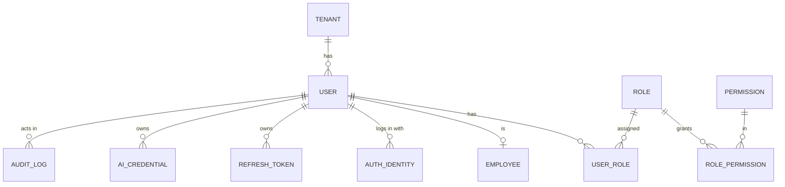
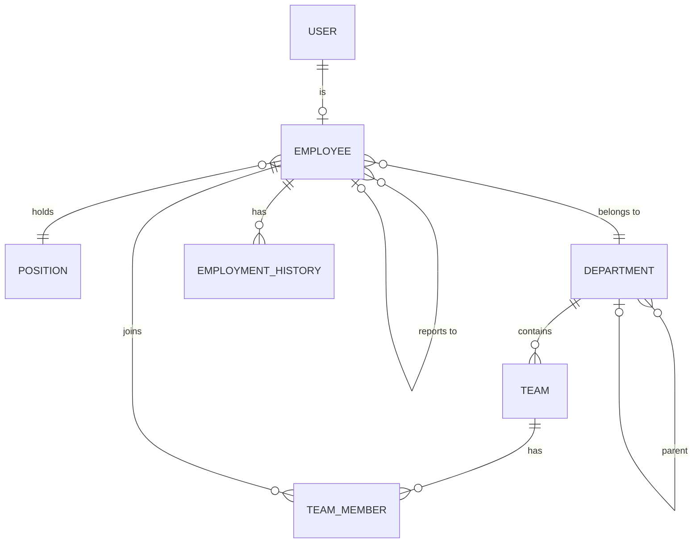
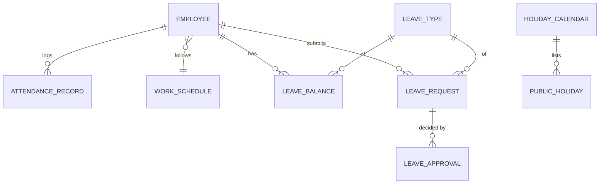
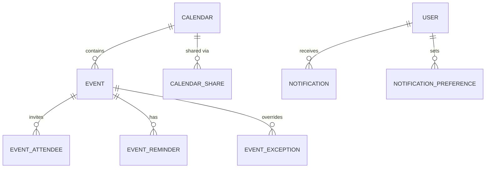
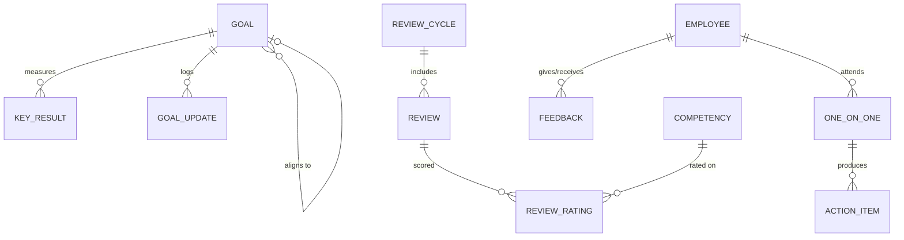
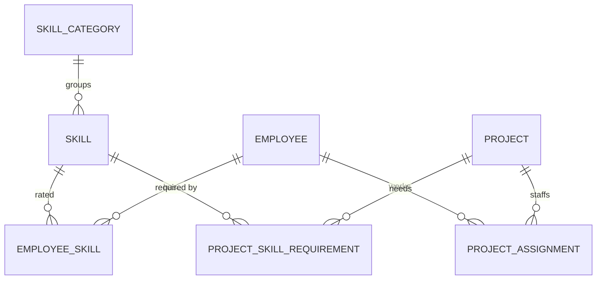
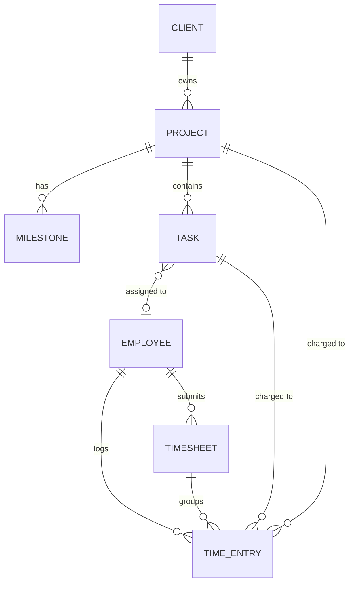

# InTime — Data Model (ERD)

PostgreSQL, EU region. Conventions apply to **every** table unless stated:

- `id uuid` primary key (UUIDv7 where possible, sortable).
- `tenant_id uuid NOT NULL DEFAULT public.app_current_tenant()` + Row Level Security enabled in the table's migration with `SELECT public.enable_tenant_rls('<table>');` (see [ADR 0001](adr/0001-multi-tenancy-rls.md)).
- `created_at`, `updated_at timestamptz`, `created_by`, `updated_by` (user id).
- Soft delete (`deleted_at`) for people-related data; hard purge by the retention job (GDPR).
- Unique constraints are always composite with `tenant_id`.
- Enums are stored as `text` + check constraint (easier migrations than PG enums).

## 1. Identity, tenancy, access

| Table                     | Key columns                                                                                                                                                                                |
| ------------------------- | ------------------------------------------------------------------------------------------------------------------------------------------------------------------------------------------ |
| `tenant`                  | name, slug, default_locale, default_timezone, country, ai_enabled, settings jsonb                                                                                                          |
| `user`                    | email (unique per tenant), status (`invited/active/disabled`), locale, timezone, email_verified_at, last_login_at                                                                          |
| `auth_identity`           | user_id, provider (`password/google`), provider_subject, password_hash (argon2id, only for `password`)                                                                                     |
| `refresh_token`           | user_id, token_hash, family_id, expires_at, revoked_at, replaced_by (reuse detection)                                                                                                      |
| `invitation`              | _(not a table: invitations are `auth_token` rows with purpose `invite`, see ADR 0002)_                                                                                                     |
| `role`                    | key (admin/hr/manager/employee for system roles, null for custom), name, description, is_system — unique (tenant, name) and (tenant, key)                                                  |
| _(no `permission` table)_ | The permission catalog lives in code (`@intime/contracts`); the database only stores grants. See [ADR 0003](adr/0003-roles-and-permissions.md)                                             |
| `role_permission`         | role_id, permission_code (validated against the catalog), **scope** (`own/reports/team/department/all`) — primary key (role, code)                                                         |
| `user_role`               | user_id, role_id (composite tenant-safe FKs; a role in use cannot be deleted)                                                                                                              |
| `audit_log`               | actor_user_id (no FK, pseudonymous), action, entity, entity_id, before jsonb, after jsonb, created_at — **append-only by privilege** (UPDATE revoked from all runtime roles; no IP stored) |
| `ai_credential`           | owner_type (`user/tenant`), owner_id, provider, model, key_ciphertext, key_iv, key_tag, key_last4, created_at (AES-256-GCM)                                                                |

## 2. Employees & organization

| Table                | Key columns                                                                                                                                                                                                                                                                                                                                                                                                                                                                                                                                                                                            |
| -------------------- | ------------------------------------------------------------------------------------------------------------------------------------------------------------------------------------------------------------------------------------------------------------------------------------------------------------------------------------------------------------------------------------------------------------------------------------------------------------------------------------------------------------------------------------------------------------------------------------------------------ |
| `employee`           | user_id (nullable, unique), employee_no, first_name, last_name, job_title, location, employment_type (`full_time/part_time/contractor/outsourced`), seniority (`intern/junior/mid/senior/lead/principal`), hire_date, termination_date, birth_date, phone, country, status (`active/inactive`) — **step 1, see [ADR 0006](adr/0006-employees.md)**; no work_email (email lives on `app_user`). Added in Organization ([ADR 0007](adr/0007-organization.md)): department_id, manager_id → employee. Later: work_schedule_id (position stays free text `job_title`). Added with file storage: avatar_url |
| `position`           | _(dropped: `job_title` stays free text on `employee`, ADR 0007)_                                                                                                                                                                                                                                                                                                                                                                                                                                                                                                                                       |
| `department`         | name (unique per workspace, case-insensitive), parent_id (tree, no cycles), head_employee_id                                                                                                                                                                                                                                                                                                                                                                                                                                                                                                           |
| `team`               | name (unique per department), department_id (required), lead_employee_id                                                                                                                                                                                                                                                                                                                                                                                                                                                                                                                               |
| `team_member`        | team_id, employee_id (primary key together)                                                                                                                                                                                                                                                                                                                                                                                                                                                                                                                                                            |
| `employment_history` | _(later: changes are in the audit log for now)_                                                                                                                                                                                                                                                                                                                                                                                                                                                                                                                                                        |

- Reporting tree: `manager_id` + recursive CTE (`WITH RECURSIVE`) to resolve `direct_reports` / `all subordinates`; cycle check on write.
- Compensation (salary, hourly rate) is the effective-dated `compensation` table (ADR 0030): basis `monthly/yearly/hourly`, `amount_minor` in minor units, currency, `valid_from`. Permissions `compensation.view` / `compensation.manage` (HR + Admin only); nobody changes their own; payroll is out of scope.

## 3. Attendance & leave

| Table               | Key columns                                                                                                                                                                                                                               |
| ------------------- | ----------------------------------------------------------------------------------------------------------------------------------------------------------------------------------------------------------------------------------------- |
| `work_schedule`     | name, weekly_hours, days jsonb (per weekday start/end/break)                                                                                                                                                                              |
| `attendance_record` | employee_id, work_date, check_in_at, check_out_at (null while open), mode (`office/remote/field`), note, source (`clock/entry/correction`) — one open record per employee, no overlaps, at most 16 h ([ADR 0009](adr/0009-attendance.md)) |
| `leave_type`        | key (system types), name (custom), tracks_balance, requires_approval, is_sick, color, is_active — see [ADR 0008](adr/0008-leave.md)                                                                                                       |
| `leave_policy`      | leave_type_id (unique), annual_allowance_days, carry_over_max_days                                                                                                                                                                        |
| `leave_balance`     | employee_id, leave_type_id, year, entitled, carried_over, adjustment — created lazily and frozen; **used/pending are sums over request days**, never stored                                                                               |
| `leave_request`     | employee_id, leave_type_id, start_date, end_date, half_day_start, half_day_end, days, reason (never for sick types), status (`pending/approved/rejected/cancelled`), decided_at                                                           |
| `leave_request_day` | request_id, day, fraction (0.5 or 1): the counted working days, stored at request time                                                                                                                                                    |
| `leave_approval`    | request_id, approver_employee_id, decision (`approved/rejected/cancelled`), comment, decided_at                                                                                                                                           |
| `holiday`           | date, name, country (null = everybody), is_half_day — custom holidays; Bulgarian and German national days are computed in code                                                                                                            |
| `leave_settings`    | tenant (one row), hide_sick_type_from_team, default_country                                                                                                                                                                               |

- **Sick leave** stores only the type — never diagnosis (GDPR special category).
- Overlap rule: an employee cannot have two pending/approved requests sharing a date (exclusion constraint on the date range).

## 4. Calendar & notifications

| Table                      | Key columns                                                                                                                                                                                                                                                              |
| -------------------------- | ------------------------------------------------------------------------------------------------------------------------------------------------------------------------------------------------------------------------------------------------------------------------ |
| `calendar_event` (Phase 1) | scope (`personal/team/company`), owner_employee_id, team_id, title, description, location, all_day, start_date/end_date, starts_at/ends_at — replaces the tables below; since ADR 0028 it also carries the repeat rule (`recurrence_freq/interval/weekdays/until/count`) |
| `calendar_event_exception` | event_id, original_date (an occurrence cancelled with `mode=this`; unique per event and date) (ADR 0028)                                                                                                                                                                 |
| `calendar_attendee`        | event_id, employee_id, response (`needs_action/accepted/declined/tentative`), responded_at; guests only on personal events (ADR 0028)                                                                                                                                    |
| `calendar_reminder`        | event_id, occurrence_date, sent_at (claims one occurrence's reminder so it is sent once; no personal data; `calendar_event.reminder_minutes` 60/1440 holds the setting) (ADR 0029)                                                                                       |
| `calendar`                 | name, owner_type (`user/team/department/company`), owner_id, color_token, is_system_layer (leave/holidays/birthdays)                                                                                                                                                     |
| `calendar_share`           | calendar_id, grantee_type (`user/team/all`), grantee_id, access (`free_busy/view/edit/manage`)                                                                                                                                                                           |
| `event`                    | calendar_id, title, description, location, meeting_url, starts_at, ends_at, all_day, timezone, rrule (nullable), visibility (`default/private/public`), organizer_id, source_type/source_id (e.g. `leave_request`, `one_on_one`)                                         |
| `event_exception`          | event_id, original_start, is_cancelled, override fields jsonb                                                                                                                                                                                                            |
| `event_attendee`           | event_id, user_id, rsvp (`pending/yes/no/maybe`), is_optional                                                                                                                                                                                                            |
| `event_reminder`           | event_id, user_id, minutes_before, channel (`in_app/email`)                                                                                                                                                                                                              |
| `notification`             | recipient_user_id, type, params jsonb (ids/non-sensitive labels), link, in_app, read_at, email_status (`none/pending/sending/sent/failed/skipped`), attempts, next attempt, sent_at                                                                                      |
| `notification_preference`  | user_id, type, channel (`in_app/email`), enabled (digest later)                                                                                                                                                                                                          |
| `outbox_event`             | type, params jsonb, status (`pending/processing/done/dead`), attempts, available_at, locked_until, last_error — queue + event log; app role can only INSERT (ADR 0004)                                                                                                   |

## 5. Goals, performance, 1:1s, feedback

| Table                    | Key columns                                                                                                                                                                                                                                                                                                                                |
| ------------------------ | ------------------------------------------------------------------------------------------------------------------------------------------------------------------------------------------------------------------------------------------------------------------------------------------------------------------------------------------ |
| `goal`                   | scope (`personal/team/company`), owner_employee_id (personal), team_id (team), parent_goal_id (strictly wider scope), title, description, status (`draft/active/done/cancelled`), manual progress_pct (used only without key results; effective progress is computed), due_date. No visibility column: visibility follows scope (ADR 0019) |
| `key_result`             | goal_id, title, unit, start_value, target_value, current_value, position                                                                                                                                                                                                                                                                   |
| `goal_update`            | goal_id, author_employee_id, progress_pct (the effective progress at check-in time), comment                                                                                                                                                                                                                                               |
| `review_cycle`           | name, period_start/end, self_due, manager_due, status (`draft/open/calibration/closed`, forward only), opened_at, closed_at (ADR 0023)                                                                                                                                                                                                     |
| `review_competency`      | cycle_id, name, description, position (competencies belong to a cycle; a new cycle can copy them)                                                                                                                                                                                                                                          |
| `review`                 | cycle_id, employee_id (unique pair), self_summary/self_submitted_at, manager_summary, overall_rating, manager_submitted_at, manager_author_id, calibrated_rating, released_at                                                                                                                                                              |
| `review_rating`          | review_id, competency_id, part (`self/manager`), score (1–5), comment                                                                                                                                                                                                                                                                      |
| `one_on_one`             | manager_employee_id, employee_id (the direct manager when made), scheduled_at, duration_minutes, status (`scheduled/done/cancelled`), agenda, shared_notes, private_notes_manager, private_notes_employee. No calendar event link yet (ADR 0020)                                                                                           |
| `one_on_one_action_item` | one_on_one_id, owner_employee_id (one of the two participants), title, due_date, done_at                                                                                                                                                                                                                                                   |
| `feedback`               | from_employee_id, to_employee_id, type (`praise/constructive/request`), body, visibility (`private_to_recipient/manager_too/public_team`), is_anonymous                                                                                                                                                                                    |

## 6. Skills, projects, capacity

| Table                       | Key columns                                                                                                                              |
| --------------------------- | ---------------------------------------------------------------------------------------------------------------------------------------- |
| `skill_category`            | name (workspace-defined, not translated, unique; compared ignoring case in the service)                                                  |
| `skill`                     | category_id, name (unique; compared ignoring case in the service), description, archived_at                                              |
| `employee_skill`            | employee_id, skill_id (unique pair), level (1–5), assessed_by_employee_id (= the employee for a self-assessment), assessed_at (ADR 0022) |
| `project`                   | name, code, client, status (`planned/active/paused/done`), start_date, end_date, lead_employee_id                                        |
| `project_assignment`        | project_id, employee_id, role, allocation_pct (1–100), from_date, to_date (open end) — no overlap per person and project (ADR 0013)      |
| `project_skill_requirement` | project_id, skill_id, min_level, headcount                                                                                               |

### 6b. Clients, tasks, time tracking

| Table                  | Key columns                                                                                                                                                                                                                                                 |
| ---------------------- | ----------------------------------------------------------------------------------------------------------------------------------------------------------------------------------------------------------------------------------------------------------- |
| `client`               | name, contact_name, contact_email, status, notes                                                                                                                                                                                                            |
| `project` (extends §6) | client_id, budget_hours, is_billable, priority, health (`on_track/at_risk/off_track`, computed)                                                                                                                                                             |
| `milestone`            | project_id, title, due_date, status                                                                                                                                                                                                                         |
| `task`                 | project_id, milestone_id, title, description, type (`functional/non_functional`), status (`todo/in_progress/review/done`), assignee_id, estimate_hours, due_date, priority                                                                                  |
| `time_entry`           | employee_id, project_id, task_id (nullable, same project), work_date, minutes (1–960), is_billable, note, source (`timer/manual`), started_at/ended_at (timer only) — a running timer = `started_at` set, `ended_at` null (max one per employee) (ADR 0015) |
| `timesheet`            | employee_id, week_start (Monday), status (`submitted/approved/rejected/open`), submitted_at, decided_by_employee_id, decided_at — created on first submit, unique per employee and week; entries belong to the sheet of their week (ADR 0015)               |
| `daily_target`         | employee_id, project_id, work_date, target_minutes                                                                                                                                                                                                          |

- Submitted and approved timesheets are locked (edits need a reject, or HR/Admin reopen with an audit log entry).
- Reports (hours per project/person/client, budget vs actual, planned vs actual) are queries/views over `time_entry`; export approved hours as CSV. No payroll calculation, no screenshots or activity monitoring (self-reported only).
- Leave-conflict check: `GET /leave/requests/:id/conflicts` lists `project_assignment`s, open `milestone`s and the person's open `task`s that fall in the dates, filtered by what the approver may see (ADR 0017). Warnings only.
- `attendance_record.reminded_at` and `time_entry.reminded_at` make the forgotten check-out / timer reminders fire once (ADR 0017).

**Capacity (computed, not stored):** for an employee and a date range =
`schedule hours − public holidays − approved leave − Σ(allocation_pct × hours)`; actual load compares this plan with logged `time_entry` hours. Exposed through a service query (`GET /capacity`, ADR 0018): a standard 8-hour day, per-person working hours come later.

**Retention (ADR 0027):** `retention_policy` (country `BG`, enabled, former_employee_months, last_run_at, last_run_erased; one row per workspace, none = preset and off) and `employee.retention_hold`.

**Working hours (ADR 0026):** `work_schedule` (employee_id, valid_from, minutes[7] Monday first, 0–960 each). No row = 8 h Monday to Friday. Capacity uses the schedule in force; overtime is logged time beyond available time, computed per day.

**Analytics (computed, not stored):** counts and sums over existing tables for the people in the caller's scope (`GET /analytics`, ADR 0024); breakdowns are withheld for groups under 5 people. No table of its own.

## 7. AI assistant (ADR 0025)

| Table                  | Key columns                                                                                                        |
| ---------------------- | ------------------------------------------------------------------------------------------------------------------ |
| `ai_workspace_setting` | enabled (default off), retention_days (1–365, default 90); one row per workspace                                   |
| `ai_credential`        | scope (`user`/`workspace`), user_id, provider, model, secret_enc (AES-256-GCM), key_version, last4                 |
| `ai_user_setting`      | user_id, consent_at, consent_version, share_people_data (default off)                                              |
| `ai_conversation`      | user_id, title, created_at, updated_at                                                                             |
| `ai_message`           | conversation_id, user_id, role (`user`/`assistant`), content, tools_used (names only; tool results are not stored) |

Retention: conversations older than the workspace's `retention_days` are purged on every chat request. The hourly limit is counted from `ai_message`.

## 8. GDPR support tables

| Table                 | Purpose                                                                              |
| --------------------- | ------------------------------------------------------------------------------------ |
| `data_export_request` | user_id, status, file_ref, requested_at — "export my data"                           |
| `erasure_request`     | employee_id, status, processed_at, legal_hold_reason                                 |
| `consent_record`      | user_id, purpose (`ai_processing/...`), granted, at, text_version                    |
| `retention_policy`    | country (BG), enabled, former_employee_months — read by the retention job (ADR 0027) |

## 9. Indexing & performance notes

- Always index `(tenant_id, <fk>)`; composite indexes for lookups like `(tenant_id, employee_id, work_date)` on attendance and `(tenant_id, employee_id, start_date)` on leave.
- `employee.manager_id` index + materialized path or recursive CTE — with ≤250 employees the CTE is fast enough; no premature optimization.
- Range overlap on leave: `EXCLUDE USING gist (employee_id WITH =, daterange(start_date,end_date,'[]') WITH &&) WHERE status IN ('pending','approved')`.
- Calendar queries: index `(tenant_id, calendar_id, starts_at)`; recurrence expanded at read time in the requested window.
